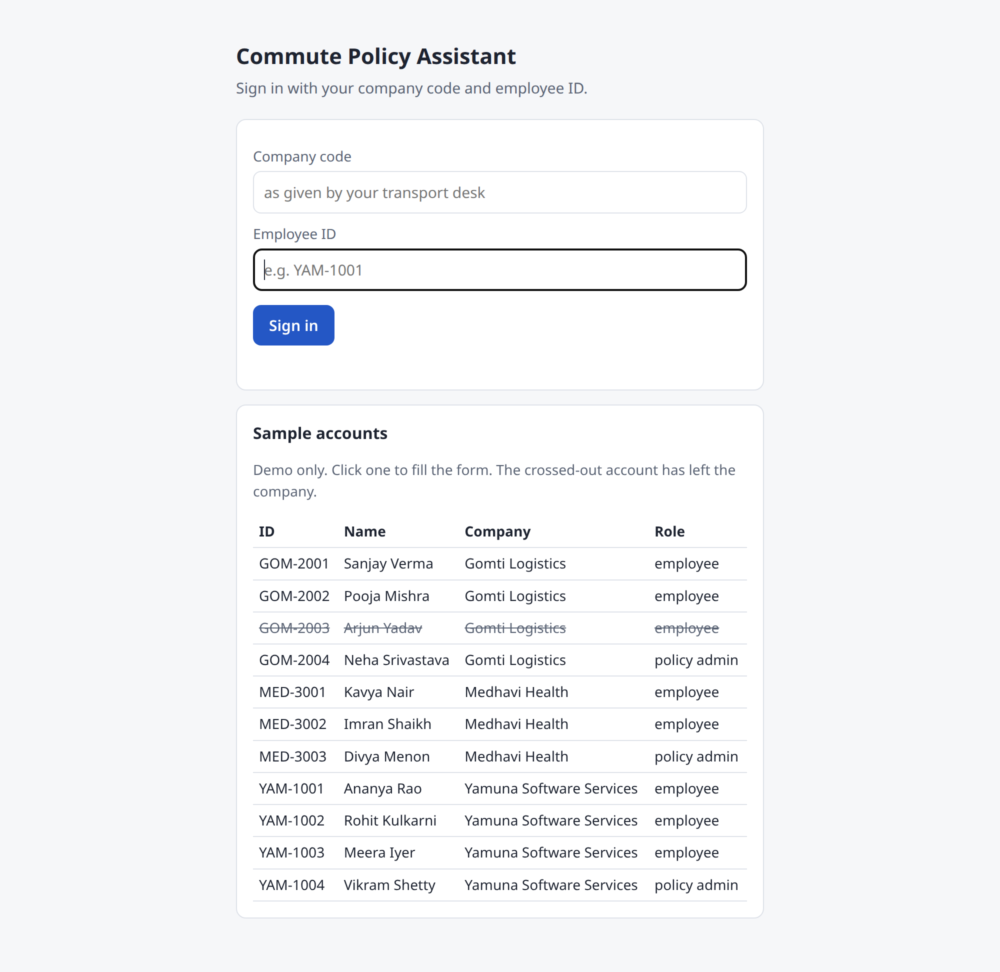
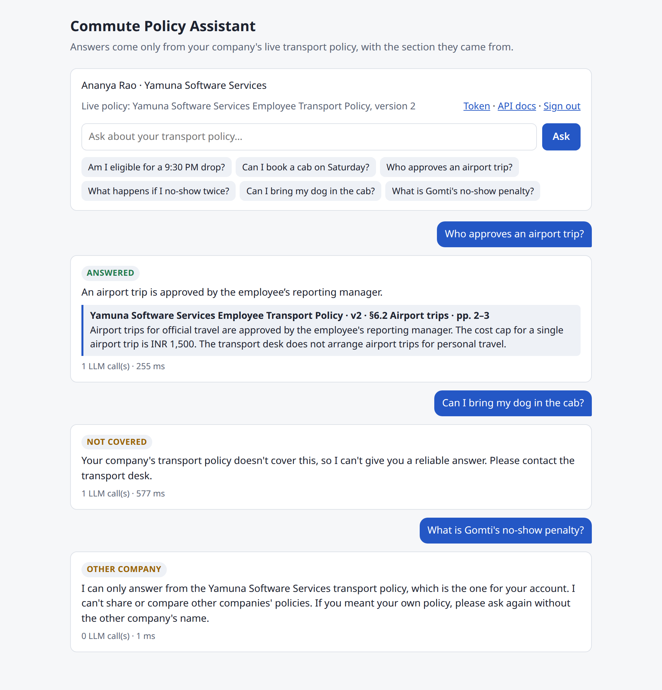
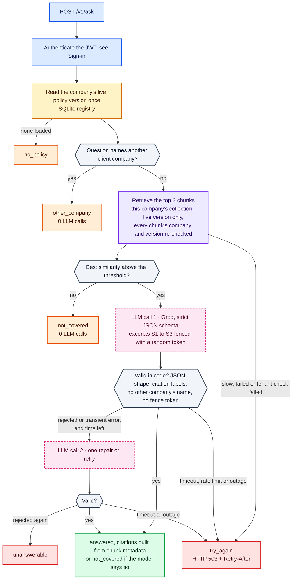

# Commute Policy Assistant

Employees ask questions like *"Am I eligible for a 9:30 PM drop?"* or *"Who approves an airport trip?"*.
The assistant answers **only from their own company's current transport policy**, cites the document
and section it used, and says plainly when the policy doesn't cover the question.

Three fictional companies share one service. Their policies cover the same topics with deliberately
contradictory rules, so any leak from one company to another would show up in an answer. Each
company's policy admin uploads new versions as PDFs, and the new version answers as soon as the upload
returns. Before uploading one, see [What a policy PDF needs](#what-a-policy-pdf-needs).

This README is the ten-minute version. The reasoning behind each decision is in
[docs/DESIGN.md](docs/DESIGN.md), policy ingestion in [docs/INGESTION.md](docs/INGESTION.md), the
evaluation in [docs/EVALUATION.md](docs/EVALUATION.md) and the sample policies in
[docs/POLICY_DATA.md](docs/POLICY_DATA.md).

---

## Run it

```bash
cp .env.example .env        # then put your free Groq key in GROQ_API_KEY
docker compose up           # builds, loads the sample policies, serves on :8000
```

Open **http://localhost:8000**. You land on the sign-in page, which lists the sample employees (click
one to fill the form). After signing in you get the chat page, and the page shows your token (masked,
with a copy button) for the API docs at http://localhost:8000/docs: press **Authorize** and paste it.

<p>
  
  &nbsp;
  
</p>

*Signed in as `YAM-1001`, three questions and three outcomes: an answer citing §6.2 of the live v2
policy on pages 2–3, a "not covered" for a question the policy is silent on, and a refusal of a
question about another company (0 LLM calls). Real replies from the running service with Groq.*

Without an API key the service still starts. Retrieval works, and questions get a clear
"the assistant isn't available" reply instead of an error.

| What | Command |
|---|---|
| Tests (no network or key needed; they fit in Docker's default 1,024 open files) | `docker compose run --rm app pytest` |
| Evaluation set (uses the LLM from `.env`, about 6 min, paced for free-tier limits). Writes `evaluation/results/eval_set.jsonl` | `docker compose run --rm app python -m evaluation.run` |
| Evaluation without a key (retrieval only) | `docker compose run --rm app python -m evaluation.run --llm none` |
| Re-score saved answers with the current checks (no LLM calls) | `docker compose run --rm app python -m evaluation.run --rescore evaluation/results/eval_set.jsonl` |
| Run the evaluation 5 times, mean ± std (resumes if a quota stops it) | `docker compose run --rm app python -m evaluation.run --llm groq --retriever dense --repeat 5` |
| Many questions at once, with a stand-in LLM (no key, no quota) | `docker compose run --rm app python -m scripts.load_test` |
| Latency of a running server, one question at a time | `python scripts/bench.py` |

To run without Docker you need Python 3.11+: `pip install -e ".[dev]"`, then `uvicorn app.main:serve --factory`.

### Configuration

All settings are environment variables, read from `.env` and defined in `app/config.py`.

| Variable | Default | Meaning |
|---|---|---|
| `GROQ_API_KEY` | – | Free key from console.groq.com. Never commit it |
| `GEMINI_API_KEY` | – | Optional fallback provider (Google AI Studio free tier) |
| `LLM_PROVIDER` | `auto` | `auto` (Groq, then Gemini, then none), `groq`, `gemini`, `none`. Groq comes first because it is faster ([why](docs/DESIGN.md#why-groq-is-the-default)) |
| `GROQ_MODEL` / `GEMINI_MODEL` | `openai/gpt-oss-20b` / `gemini-3.5-flash-lite` | Model names |
| `RETRIEVER` | `dense` | `dense`, or `hybrid` (BM25 + dense, measured and not shipped) |
| `CONTEXTUAL_HEADERS` | `true` | Index each chunk with its heading path (the measured retrieval improvement) |
| `EVIDENCE_MIN_SIMILARITY` | `0.25` | Below this, "not covered" without calling the LLM |
| `MAX_LLM_CALLS` / `MAX_CITED_CHUNKS` | `2` / `3` | Hard per-question limits (validated, can't be raised past the brief) |
| `REQUEST_DEADLINE_S` / `LLM_TIMEOUT_S` / `RETRIEVAL_TIMEOUT_S` | `2.8` / `2.2` / `0.8` | Time budget per question |
| `JWT_SECRET` | dev value | Signs the tokens issued at login. With `APP_ENV=prod` the service refuses to start on the dev value |
| `JWT_TTL_MINUTES` | `480` | How long a sign-in lasts (one shift) |
| `EMPLOYEE_DIRECTORY` | `data/employees.json` | The mock HR directory login checks against. Edits apply without a restart |
| `MAX_SESSIONS_PER_EMPLOYEE` | `5` | Signing in on one more device ends the oldest session |
| `LOGIN_MAX_FAILURES` / `LOGIN_FAILURE_WINDOW_S` | `10` / `300` | Failed sign-ins allowed per client in the window, then HTTP 429 |
| `TOKEN_RETENTION_DAYS` | `30` | Expired and revoked token records are kept this long, then purged at startup |
| `APP_ENV` | `dev` | `dev` lists the sample accounts at `GET /dev/accounts` and allows the session cookie over plain HTTP |

---

## API

| Endpoint | Who | What |
|---|---|---|
| `POST /v1/auth/login` | anyone | `{"company_id": "yamuna", "employee_id": "YAM-1001"}` → a fresh JWT, the employee and company |
| `POST /v1/auth/logout` | anyone with a token | Revokes that token (other devices stay signed in) |
| `GET /v1/me` | anyone with a token | Who the token says you are, and when it expires |
| `POST /v1/ask` | employee | `{"question": "..."}` → answer, status, citations |
| `GET /v1/policies/active` | anyone with a token | Which policy version answers for my company |
| `POST /v1/policies` | `policy_admin` | Upload a new version (a PDF, as a file upload) for **their own** company |
| `GET /dev/accounts` | dev only | The sample employees and their companies, for the sign-in page |

Pages: `/login` is open; `/`, `/docs` and `/redoc` send a signed-out browser to `/login` and back.
The client list is not published: the sign-in form takes a company code (`yamuna`, `gomti`,
`medhavi`), and only the dev-mode sample accounts show company names.

Sample accounts (in `data/employees.json`): Yamuna `YAM-1001`..`YAM-1003`, Gomti `GOM-2001`, `GOM-2002`,
Medhavi `MED-3001`, `MED-3002` are employees. The policy admins are `YAM-1004`, `GOM-2004` and `MED-3003`.
`GOM-2003` has left the company, so signing in with it is refused.

```bash
TOKEN=$(curl -s -XPOST localhost:8000/v1/auth/login -H 'content-type: application/json' \
  -d '{"company_id":"yamuna","employee_id":"YAM-1001"}' | python3 -c 'import sys,json;print(json.load(sys.stdin)["access_token"])')

curl -s -XPOST localhost:8000/v1/ask -H "authorization: Bearer $TOKEN" \
  -H 'content-type: application/json' -d '{"question":"Who approves an airport trip?"}'
```

```json
{
  "status": "answered",
  "answer": "An airport trip is approved by the employee's reporting manager.",
  "citations": [{"document": "Yamuna Software Services Employee Transport Policy", "version": 2,
                 "section": "6.2", "title": "Airport trips",
                 "excerpt": "Airport trips for official travel are approved by the employee's reporting manager. The cost cap for a single airport trip is INR 1,500.",
                 "page_start": 2, "page_end": 3}],
  "policy": {"document": "Yamuna Software Services Employee Transport Policy", "version": 2},
  "meta": {"llm_calls": 1, "latency_ms": 1322.4},
  "request_id": "3f9c0a1b2d4e"
}
```

| `status` | Meaning |
|---|---|
| `answered` | Answer with citations |
| `not_covered` | The policy is silent. A fixed message points to the transport desk |
| `other_company` | The question names another client company. Polite refusal |
| `no_policy` | No policy loaded for this company yet |
| `unanswerable` | The model's reply failed validation twice. "Rephrase or contact the desk" |
| `try_again` | Timeout, provider outage or rate limit. HTTP 503 with `Retry-After` |

Errors have the same `{status, message, request_id}` shape:

| HTTP | `status` | When |
|---|---|---|
| 401 | `unknown_account` | The company code or the employee ID is wrong. One reply for both, so sign-in can't confirm who our clients are |
| 403 | `account_inactive` | The employee has left (`"active": false` in the directory) |
| 429 | `too_many_attempts` | Too many failed sign-ins from this client. `Retry-After` says how long to wait |
| 401 | `unauthorized` | Missing, forged, expired, logged-out or superseded token, or the employee has since left or changed role |
| 503 | `auth_unavailable` | The token store can't be read. Requests fail closed, with `Retry-After` |

---

## Policies

### What a policy PDF needs

Check these before uploading. A PDF that misses one is refused with a message naming the problem, and
the live version keeps answering. Nothing is guessed, because every answer cites a section number and
a version.

1. **A text PDF**, as a word processor or a browser's print to PDF makes one (Word-style, LibreOffice
   and Chrome exports are tested). A scan has no text to cite, so run OCR first. No password, at most
   10 MB and 150 pages, one column of text.
2. **A document-control block on page 1, before the first section**, as a table or as
   `Label: value` lines:

   | Label | Rule |
   |---|---|
   | **Document ID** (or Document number, Doc ID) | Required. For a company that already has a policy, the same Document ID as the live one: each company has one transport policy |
   | **Version** | Required. A whole number (`3`, not `v3` or `2.0`), higher than the live version |
   | **Effective from** (or Effective date) | Required. A date: `2026-12-01`, `1 December 2026`, `1st Dec 2026`, `December 1, 2026`. Upload on or after this date: a policy that hasn't taken effect yet is refused, so it can't answer early |
   | Company, Company ID | Optional. Left out, the policy is filed under your company. If given, the Company ID must be yours |
   | Title (or Policy title) | Optional when the title is the largest text on page 1 |

3. **Numbered section headings, in bold or a larger size than the body text**: `4. Night travel`,
   `4.2 Security escort`. `Section 4: …`, `Clause 4 - …`, `4) …`, `4.0 …` and `IV. …` are read as
   section 4. Each number is used once, and a subsection comes after its parent (`4.2` under `4`).
   Headings without numbers, or set apart only by colour, can't be cited and are refused.

Running headers and footers, "Page X of Y", a contents page, tables and bullet lists are all fine.
A first page that works:

```text
Kaveri Foods Employee Transport Policy        ← the largest text on page 1

Document ID     kaveri-transport-policy
Version         3
Effective from  1 November 2026

1. Purpose and scope                          ← bold or larger
1.1 Purpose
This policy explains who can use company transport ...
```

How the parser reads all this, and what it was tested on, is in
[design §4](docs/DESIGN.md#4-reading-policy-pdfs-by-layout-refusing-what-cant-be-cited).

### Uploading a policy

Sign in as the company's policy admin (`YAM-1004`, `GOM-2004` or `MED-3003`), then send the PDF. After
`@`, give the path to the file on your own machine.

```bash
ADMIN=$(curl -s -XPOST localhost:8000/v1/auth/login -H 'content-type: application/json' \
  -d '{"company_id":"yamuna","employee_id":"YAM-1004"}' | python3 -c 'import sys,json;print(json.load(sys.stdin)["access_token"])')

curl -s -XPOST localhost:8000/v1/policies -H "authorization: Bearer $ADMIN" -F file=@/path/to/yamuna-v3.pdf
# {"company_id":"yamuna","version":3,"activated":true,"previous_version":2,...}
```

The new version answers as soon as the call returns, with no restart. The `/docs` page offers the same
upload with a file picker. To make a test v3, copy `data/archive/markdown-policies/yamuna/v2.md`,
change `version: 2` to `version: 3` and a rule or two, and run
`python scripts/make_policy_pdfs.py yamuna-v3.md yamuna-v3.pdf`.

Every mistake is refused before anything is stored, and the live version keeps answering:

| Uploaded | Result |
|---|---|
| A higher version (gaps allowed, v2 → v7) | 200, activated |
| The live version again, unchanged | 200, `already active`, nothing done |
| The live version number with edited text, or a lower number | 409 `version_conflict` |
| A policy whose effective date is still to come | 409 `not_yet_effective`, naming the date to upload it on |
| A different document from the company's live policy (another Document ID) | 409 `different_document`, naming the document to update |
| A Company ID that isn't the uploader's | 403 |
| Version missing, or `v3`, `2.5`, `0`; not a PDF, damaged, password-protected or scanned; headings that aren't bold or larger, a duplicate section, a subsection outside its parent | 422 `invalid_policy`, naming the problem (and the page) |

How the switch is made atomic, and what happens at every failure and crash point, is in
[docs/INGESTION.md](docs/INGESTION.md).

### Adding a client company

There's no registration endpoint, by design: a client exists because its HR system lists employees for
it, and `data/employees.json` stands in for that system. Onboarding is two steps, with no restart:

1. Add the company to `data/employees.json` with at least one `policy_admin`. The running service picks
   up the edit on the next request.
2. Sign in as that admin and upload the policy PDF, as above. It is filed under the admin's company.

Before step 1, signing in to the new company is refused, so no one can create a tenant just by
uploading a document. Removing a company from the directory locks its employees out on the next
request, and its policy is deleted at the next startup.

---

## How it works

One FastAPI process, two SQLite files and an embedded Chroma store on one Docker volume, and a small
embedding model that runs locally. The only call that leaves the machine is the one LLM call per
question, and it carries just the 3 policy excerpts and the question.


Colours mean the same in every diagram: blue for routes and code steps, violet for services, amber for
stored data, teal for the local model, dashed pink for the hosted LLM, green for success, orange for a
safe refusal, red for an error.

Answering a question:



A new policy version is written next to the live one, invisible to searches, and then one SQLite row
flips which version is live. A failure at any step leaves the old version answering
([docs/INGESTION.md](docs/INGESTION.md)).

---

## Design decisions in brief

Each has a full section, with the reasoning and the numbers, in [docs/DESIGN.md](docs/DESIGN.md).

1. **Isolation is one boundary, checked twice.** The company comes only from the signed token and
   alone picks the Chroma collection and the live version a search reads; the request body can't name
   either. Every retrieved chunk is checked again, failing closed. A question or an answer that names
   another client is refused, but that is an answer-quality heuristic, not the isolation guarantee
   ([§1](docs/DESIGN.md#1-isolation-one-boundary-checked-twice)).
2. **Sign-in is a mock HR directory** with a fresh, revocable JWT per login, checked against a token
   store and the directory on every request. The client list isn't published
   ([§2](docs/DESIGN.md#2-sign-in-a-mock-directory-a-fresh-token-per-login-every-token-revocable)).
3. **A new version replaces the old one in one SQLite transaction.** Chunks are written invisibly,
   then one row flips. Versions only move forward, a policy can't go live before its effective date,
   and each company has one policy document
   ([§3](docs/DESIGN.md#3-a-new-policy-version-replaces-the-old-one-atomically), [INGESTION.md](docs/INGESTION.md)).
4. **PDFs are read by layout, and what can't be cited is refused** rather than guessed: a heading is a
   numbered line in bold or a larger size ([§4](docs/DESIGN.md#4-reading-policy-pdfs-by-layout-refusing-what-cant-be-cited)).
5. **One chunk per numbered section, dense search, top 3.** Each chunk is embedded with its heading
   path ([§5](docs/DESIGN.md#5-chunking-and-retrieval-one-section-per-chunk-dense-search-top-3)).
6. **Citations come from stored metadata, never from model text.** The model only picks a label it was
   shown; code maps it to document, version, section and pages
   ([§6](docs/DESIGN.md#6-grounding-and-the-policy-does-not-say)).
7. **Prompt injection is handled in layers,** and the one that matters most is that the model has no
   tools and only sees the caller's own excerpts ([§7](docs/DESIGN.md#7-prompt-injection-layered-because-no-single-layer-is-enough)).
8. **The LLM only reads three excerpts and phrases the answer.** Identity, versions, refusals,
   citations and error wording are code ([§8](docs/DESIGN.md#8-where-the-llm-earns-its-place-and-where-plain-code-is-better)).
9. **Every failure ends in a plain sentence** and a request id; no exception text reaches a response
   ([§9](docs/DESIGN.md#9-failures-always-end-in-a-sentence-a-person-can-act-on)).
10. **A hosted LLM (Groq, Gemini as fallback), not a local one,** because there was no GPU to measure
    one fairly ([§10](docs/DESIGN.md#10-a-hosted-llm-not-a-local-one-because-there-was-no-gpu-to-test-one-on)).

## Staying inside the numbers

- **At most 2 LLM calls.** A per-question budget that every call spends from; the second call only
  repairs an invalid reply or retries a transient error, and only if at least 0.8 s of the deadline is
  left. SDK auto-retries are off. "Other company" and low-evidence questions make 0 calls.
- **At most 3 cited chunks.** Retrieval returns 3, and the reply's JSON schema only allows the 3 labels
  shown.
- **p95 under 3 s.** Local embeddings (about 40 ms), one LLM call, and a hard 2.8 s deadline that each
  call is cut off at by the service itself.

| Measured | p50 | p95 |
|---|---|---|
| Evaluation set, 58 questions, one at a time | 772 ms | 1303 ms |
| The same set, 5 runs (median of the runs) | 746 ms | 1122 ms |
| `bench.py` over HTTP, Docker | 690 ms | 914 ms |
| `load_test`, 16 questions at once, stand-in LLM, 2 runs | 0.82–0.86 s | 1.25–1.27 s |

Up to 16 questions at once stay inside the target on a laptop; beyond that the CPU-bound embedder is
the limit, and the free tier's roughly 8 questions a minute would bind long before. The timeline, the
load results and the bugs they found are in [design §11](docs/DESIGN.md#11-staying-inside-the-numbers).

## Evaluation

58 questions across the three companies (`evaluation/cases.jsonl`), scored in code with no LLM judge,
and every citation checked against the raw PDF text. The submitted run
([`evaluation/results/eval_set.jsonl`](evaluation/results/eval_set.jsonl), in the brief's
`id, input, expected, actual, pass, notes` format) passed 57/58, and five repeated runs of the shipped
setting passed 56.4 ± 0.55. The method, every run, what changed between them and the known failures
are in [docs/EVALUATION.md](docs/EVALUATION.md).

## Retrieval improvement (bonus)

**Shipped: contextual section headers.** Each chunk is embedded as `<document title> > <section path>`
followed by its text. On the original 43 questions, same model, back to back:

| | Plain chunks | **Contextual headers** |
|---|---|---|
| Evaluation passed | 38 / 43 | **42 / 43** |
| Retrieval hit@1 / hit@3 / MRR | 0.839 / 0.903 / 0.871 | **0.871 / 0.968 / 0.919** |

Short sections like *"Each trip is capped at INR 600."* barely say what they are about; the heading
supplies it, for about 15 tokens per chunk at indexing time and nothing at query time.

**Measured, not shipped: hybrid BM25 + dense** (`RETRIEVER=hybrid`). It ranks the right section first
more often (39/43 vs 35/43) but doesn't put it in the top 3 more often (42/43 each), and over 5 runs
it passed fewer cases (55.6 vs 56.4). Details in
[EVALUATION.md §3.7–3.8](docs/EVALUATION.md#37-dense-vs-hybrid-on-the-pdf-policies).

## The sample policies

Three short policies, built on the clause structure of real Indian corporate transport policies
(sources and what each contributed: [docs/POLICY_DATA.md](docs/POLICY_DATA.md)). All values are
invented. The contradictions:

| Topic | Yamuna (v2) | Gomti | Medhavi |
|---|---|---|---|
| Eligibility | Grades L1–L5, > 5 km | Every grade, > 3 km | Rostered shift staff |
| Cut-off | 4 hours | 2 hours | 6:00 PM the day before |
| Escort for women | After 7:30 PM (8:00 PM in v1) | After 10:00 PM | After 9:00 PM |
| Weekends | L2 manager approval | Not provided, INR 500 reimbursement | Rostered automatically |
| Airport trips | Reporting manager, INR 1,500 | Transport Head, INR 2,000 | *Not covered* |
| Standard cap | INR 900 (800 in v1) | INR 1,000 | INR 600 |
| No-show | 2 → warning, 3 → 7-day suspension | INR 250 each after the first | 3 → off roster for a month |
| Guests | Not allowed | HR approval, host travels | *Not covered* |

## Project layout

```
app/
  auth/          employee directory, JWT issuing and checking, token store, login service → Principal
  api/           routes, request/response schemas, error → JSON mapping
  policies/      PDF and Markdown parsers, chunker, injection scanner, version registry, ingestion, seeding
  retrieval/     embedders, Chroma store, BM25, dense/hybrid retrievers
  llm/           LLM interface, Groq/Gemini clients, scripted fake, call budget + deadline
  answering/     prompt (spotlighting), output schema, validator, citations, other-company names, service
  config.py      every tunable, from env
  container.py   builds the object graph (no DI framework) and closes it
data/policies/   three companies' policies as PDFs (Yamuna has v1 and v2)
data/archive/markdown-policies/  the Markdown the PDFs were generated from
data/employees.json  mock HR directory: 3–4 employees per company, one policy admin each
evaluation/      cases.jsonl (questions), scoring, runner, results/ (scored runs, 5-run repeats)
tests/           561 tests, no network; fixtures/pdf_producers/ holds PDFs made by Word, Writer and Chrome
scripts/         bench.py (latency), load_test.py (many questions at once), make_policy_pdfs.py,
                 check_pdf_producers.py (reads the policies laid out by Word, Writer and Chrome)
constraints.txt  exact versions of every package in the tested image
docs/            DESIGN.md, INGESTION.md, EVALUATION.md, POLICY_DATA.md, images/
```

## Known limitations

- **Retrieval misses.** Over 5 runs, *"Can an intern ride the company cab?"* always gets a safe "not
  covered" (dense search misses the intern section), and an eligibility answer can leave out a
  condition that ranks below the top 3 ([EVALUATION.md §4](docs/EVALUATION.md#4-known-failures)).
- **Short policies.** The brief asks for three short documents; real ones run to 10–30 pages, which
  would mean more sections competing in retrieval and more pressure on the 3-chunk cap.
- **One process.** The token store, policy registry and ingestion lock assume a single server process.
- **One policy document per company,** and a policy is uploaded on or after its effective date rather
  than scheduled ([design §3](docs/DESIGN.md#3-a-new-policy-version-replaces-the-old-one-atomically)).
- **Sign-in is a mock:** no password, an in-memory failed-login limit, no "sign out everywhere"
  ([design §14](docs/DESIGN.md#14-sign-in-gaps-left-on-purpose)).
- **PDFs:** scans need OCR first, and two-column layouts aren't detected.
